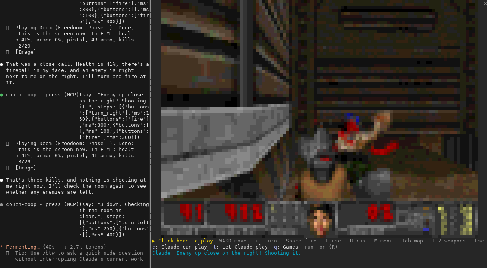
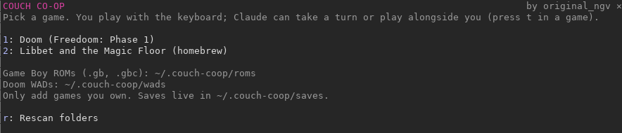
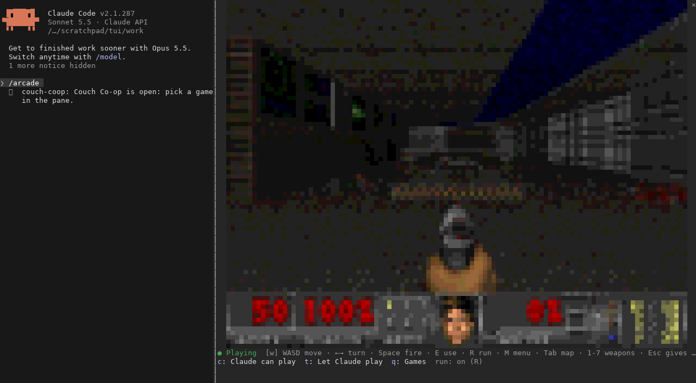
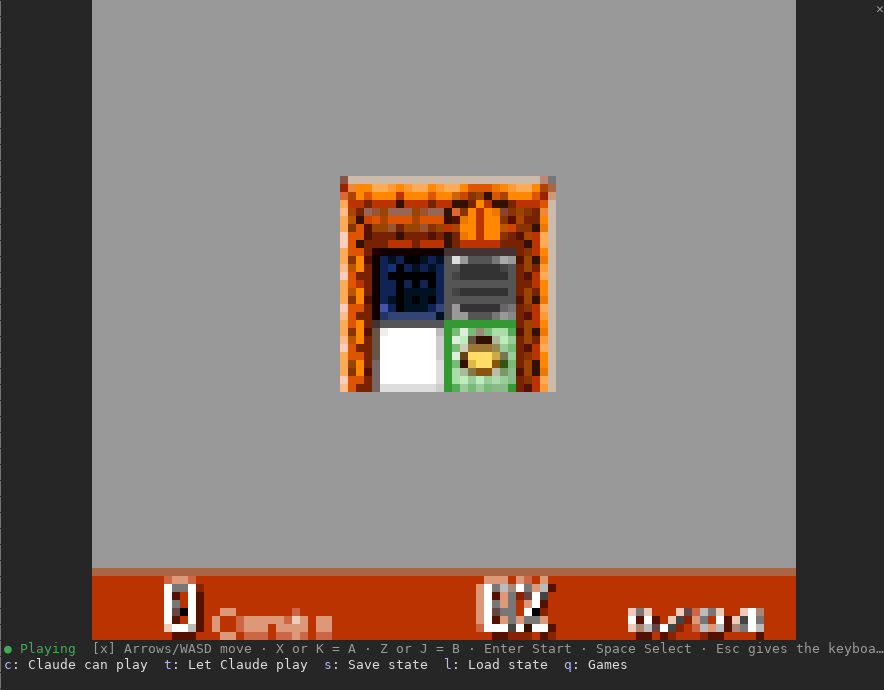
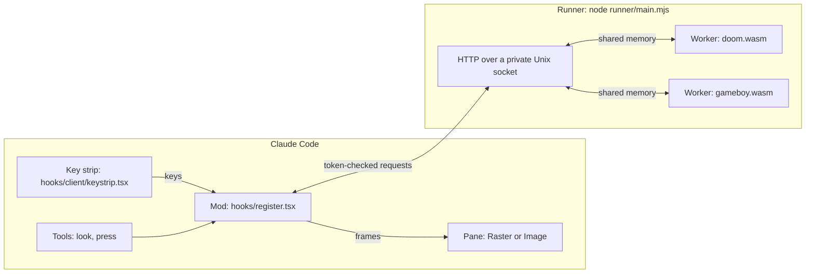

# Couch Co-op

**An arcade inside Claude Code.** Play Doom and Game Boy games in a pane next to your conversation, on your own or co-op with Claude.



Couch Co-op is a Claude Code plugin built on [mods](https://code.claude.com/docs/en/plugins/mods/overview). Type `/doom` and the real Doom engine draws into a pane in your terminal. Click the strip under the picture and your keyboard plays it. Ask Claude to take a turn and it looks at the screen and presses the buttons itself, narrating as it goes.

- **Doom**, the original engine (doomgeneric), with [Freedoom](https://freedoom.github.io), the free game data, downloaded on first play.
- **Game Boy and Game Boy Color**, through the open-source [binjgb](https://github.com/binji/binjgb) emulator. Ships with the homebrew game *Libbet and the Magic Floor*; add ROMs you own, like Pokemon, to play those.
- **Co-op with Claude.** Claude gets two tools, `look` and `press`, and a skill that teaches it to play. It can play alone (the game waits while it thinks) or alongside you.
- **Saves.** Doom saves from its menu; Game Boy battery saves (Pokemon's in-game save) are kept on disk, plus one-button save states.
- **Nothing to compile.** Both engines are WebAssembly, run by Node.js in a separate process, so a busy game never slows Claude Code down.

## Requirements

- **Claude Code 2.1.287 or newer**, in a terminal (the CLI). Mods are on by default.
- **Fullscreen rendering**, so a click can hand the keyboard to the game: run `/tui fullscreen` once. It is already the default for most people.
- **Node.js 20 or newer** (`brew install node`, or [nodejs.org](https://nodejs.org)).
- macOS or Linux. A terminal with truecolor works best: iTerm2, Ghostty, kitty, WezTerm, Terminal.app.

## Install

In Claude Code:

```text
/plugin marketplace add ngv-sama/couch-coop
/plugin install couch-coop@couch-coop
```

Claude Code may offer to configure the plugin's settings. The defaults work, so you can skip that. Start a new session (or run `/reload-plugins`) and type `/arcade`.

To run it from a local copy instead, for development:

```bash
git clone https://github.com/ngv-sama/couch-coop.git
claude --plugin-dir ./couch-coop
```

## Play

| Command | What it does |
| --- | --- |
| `/arcade` | Opens the launcher with every game you can play |
| `/doom` | Starts Doom with Freedoom (downloads it the first time, 24 MB) |
| `/doom doom2` | Starts Doom with a WAD you added whose name matches |
| `/gameboy` | Starts the bundled homebrew game |
| `/gameboy pokemon` | Starts the first ROM in your folder whose name matches |

Then **click the strip under the picture** (it says *Click here to play*). Your keys now go to the game. **Esc** gives the keyboard back to Claude Code. The game keeps its place when you close the pane and picks up when you open it again.



### Doom controls



| Key | Action |
| --- | --- |
| `W` `S` or `↑` `↓` | Move forward, back |
| `←` `→` | Turn |
| `A` `D` | Strafe |
| `Space` or `F` | Fire |
| `E` | Use: doors, switches |
| `R` | Run on or off (on by default) |
| `1` to `7` | Weapons |
| `Tab` | Automap |
| `M` | Menu (Doom's Esc) |
| `Enter`, `Backspace`, `Y`, `N` | Menu select, back, yes, no |
| `P` | Pause |

Terminals report key presses but not releases, so a held key keeps its button down for as long as it auto-repeats.

### Game Boy controls

| Key | Button |
| --- | --- |
| Arrows or `W` `A` `S` `D` | D-pad |
| `X` or `K` | A |
| `Z` or `J` | B |
| `Enter` | Start |
| `Space` or `Backspace` | Select |



### The buttons under the game

These work with a click, or with their letter while the pane has focus (`ctrl+x tab`).

| Button | What it does |
| --- | --- |
| `c` Claude can play / Claude benched | Lets Claude press buttons, or keeps the controller yours (Claude can still look) |
| `t` Let Claude play | Puts a request in your prompt box; press Enter to hand Claude the controller |
| `s` / `l` Save state, Load state | Game Boy only: snapshot the whole game and come back to it |
| `q` Games | Stops the game and goes back to the launcher |

## Play with Claude

Press **Let Claude play**, or just ask in the chat: *"take a turn at Doom"*, *"get us through the first gym"*, *"you aim, I'll move"*.

Claude uses two tools the plugin adds while a game is open:

- `look` shows Claude the screen, plus a line about the state of play (for Doom: the level, health, ammo, whether a menu is open or you died).
- `press` holds buttons for set times, then shows Claude the new screen. Claude adds a short line of narration, shown under the game.

When you are not playing, the game **pauses between Claude's moves**, so it can take its time. Press any key and the game runs in real time for you both. The `couch-coop:play` skill teaches Claude the controls and tactics.

The first time Claude uses a tool, Claude Code asks for permission. Choose the option that stops asking for this tool if you want uninterrupted play. Each press sends Claude a screenshot, which uses your plan's usage; the skill tells Claude to play in short bursts and check in with you.

## Your own games

| What | Where |
| --- | --- |
| Game Boy ROMs (`.gb`, `.gbc`) | `~/.couch-coop/roms` (or the folder you set) |
| Doom WADs (`doom.wad`, `doom2.wad`, ...) | `~/.couch-coop/wads` |
| Saves | `~/.couch-coop/saves` |

Add files, then press **Rescan folders** in the launcher. **Only add games you own.** ROMs and commercial WADs are copyrighted, so Couch Co-op never downloads or includes them; dump your own cartridges or use your own copies.

## Settings

Change these in `/config` under Couch Co-op, or with `/plugin configure couch-coop@couch-coop`.

| Setting | Default | What it does |
| --- | --- | --- |
| Node.js path | empty | Which `node` runs the games. Empty finds it on your PATH, Homebrew, Volta or nvm |
| Game Boy ROMs folder | empty | Where your ROMs are. Empty means `~/.couch-coop/roms` |
| Picture | `auto` | `blocks`: colored half-block characters, works everywhere. `pixels`: real pixels in kitty and Ghostty. `auto` picks pixels where they work |
| Frames per second | `24` | How often the picture refreshes, 5 to 30 |

## How it works



The mod starts the runner when you open the arcade. The runner hosts one game at a time in a worker thread and shares frames and key presses with it through shared memory. About 24 times a second the mod fetches the newest frame, already packed as terminal cells, and repaints the pane. More detail in [docs/ARCHITECTURE.md](docs/ARCHITECTURE.md).

## Troubleshooting

| Problem | Fix |
| --- | --- |
| *Needs Node.js 20 or newer* | Install or update Node (`brew install node`), or set its path in `/config` |
| Clicking the strip does nothing | Run `/tui fullscreen`. In iTerm2, turn on Settings, Profiles, Terminal, *Enable mouse reporting* |
| The picture looks blocky | That's the half-block mode. In kitty or Ghostty, set Picture to `pixels` |
| The game stutters | Lower Frames per second in `/config`, or make the terminal window smaller |
| Freedoom will not download | It comes from GitHub on first play. Check your connection, or put `freedoom1.wad` in `~/.couch-coop/wads` yourself |
| A ROM does not start | Check it is a `.gb` or `.gbc` file. Game Boy Advance games are not supported |
| Nothing at all happens | Run `claude --debug` and look for lines starting with `couch-coop` |

## Develop

See [CONTRIBUTING.md](CONTRIBUTING.md) for the project layout, tests and how to rebuild the engines.

```bash
npm test                     # the runner's tests (Node's built-in runner)
npm run test:mod             # the mod's tests (claude plugin test)
npm run validate             # claude plugin validate --strict
```

## Credits and licenses

Couch Co-op's own code is under the [MIT License](LICENSE). It includes or downloads work by others, each under its own license; [THIRD_PARTY_NOTICES.md](THIRD_PARTY_NOTICES.md) has the details.

| Part | By | License |
| --- | --- | --- |
| Doom engine (`engines/doom`, `runner/cores/doom.wasm`) | id Software, the Chocolate Doom authors, ozkl (doomgeneric) | GPL-2.0-or-later |
| Freedoom game data (downloaded at first play) | The Freedoom project | BSD-3-Clause |
| Game Boy emulator (`engines/gameboy/binjgb`, `runner/cores/gameboy.wasm`) | Ben Smith (binjgb) | MIT |
| *Libbet and the Magic Floor* (`runner/roms/libbet.gb`) | Damian Yerrick | Zlib |

Made by Nikhil Guru Venkatesh ([@ngv-sama](https://github.com/ngv-sama)).

Couch Co-op is a community project. It is not made or endorsed by Anthropic, id Software, ZeniMax, Bethesda or Nintendo. DOOM is a trademark of ZeniMax Media. Game Boy and Pokemon are trademarks of Nintendo. Claude is a trademark of Anthropic.
